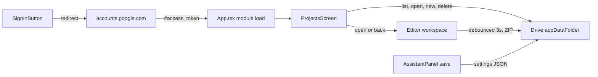

# Google sign-in, a Drive Projects screen, and API keys in Google Drive

Following the Karpathy guidelines: the smallest change that works, surgical edits, stated assumptions, and checks you can run.

## Files touched: 4 changed, 0 added

- [latex-editor/src/App.tsx](latex-editor/src/App.tsx): sign-in, Drive storage, project sync, the new `ProjectsScreen` component, and its entry points.
- [latex-editor/src/styles.css](latex-editor/src/styles.css): the Projects screen layout. A full page cannot reuse the existing menu styles.
- [latex-editor/src/AssistantPanel.tsx](latex-editor/src/AssistantPanel.tsx): syncs assistant settings and the API key with the user's Google account.
- [latex-editor/README.md](latex-editor/README.md): setup steps, plus correcting the sentences that say the app has no accounts or cloud storage.

Unchanged: `main.tsx`, `vite.config.mjs`, `index.html`, `assistant.ts`, and everything under `docs/`. The repo's documentation policy asks for an ADR on architecture changes like this one. We skip it to keep the file count down, and it can be added later.

## Assumptions and tradeoffs

- **The Projects screen is a full page.** It replaces everything below the title bar until you open a project, create one, or press "Back to editor". The editor stays mounted and is only hidden, so the undo history, assistant chat and PDF are still there when you return.
- **It opens after sign-in.** It appears after a normal sign-in, but not after "Sign in again" when the one-hour token expires, so an hourly re-sign-in does not interrupt your writing. It can also be opened at any time from the Projects button.
- **Redirect sign-in, not a popup.** The app sends `Cross-Origin-Opener-Policy: same-origin`, which breaks Google's popup sign-in. A full-page redirect works with the current headers and needs no Google script. The page reload drops the in-memory PDF; the source is already autosaved locally.
- **The sign-in lasts one hour.** Without a backend there is no refresh token. When it expires, Drive saves pause, local autosave keeps running, and the button changes to "Sign in again".
- **Scopes are `openid email https://www.googleapis.com/auth/drive.appdata`.** The app can reach only its own hidden Drive folder.
- **The API key is stored as plain text** in a hidden `assistant-settings.json`. "Remember on this device" stays local to each device.
- **If two devices edit the same project, the last save wins.**
- **You need to create the Google OAuth client ID yourself**; the README gives the steps. Without `VITE_GOOGLE_CLIENT_ID`, the app shows no Google UI.



Each project is one ZIP file in `appDataFolder`, with `appProperties: { type: "project", mainFile, activeFile }`. The ZIP contains every file, including images.

---

## 1. [latex-editor/src/App.tsx](latex-editor/src/App.tsx)

### A. Imports (lines 27-61)
- Add `ArrowClockwise`, `Cloud`, `CloudArrowUp`, `GoogleLogo`, `SignOut` and `Trash` to the `@phosphor-icons/react` import. `Plus`, `CaretLeft` and `SpinnerGap` are already imported.
- Change line 61 to `import AssistantPanel, { type AccountSettings } from "./AssistantPanel";`.

### B. Constants (after line 183)

```ts
const DRIVE_PROJECT_KEY = "latex-editor:drive-project:v1";
const DRIVE_DIRTY_KEY = "latex-editor:drive-dirty:v1";
const GOOGLE_SESSION_KEY = "latex-editor:google-session:v1";
const GOOGLE_STATE_KEY = "latex-editor:google-state:v1";
const GOOGLE_CLIENT_ID: string = import.meta.env.VITE_GOOGLE_CLIENT_ID ?? "";
const GOOGLE_SCOPES = "openid email https://www.googleapis.com/auth/drive.appdata";
const DRIVE_SAVE_DELAY = 3000;
```

### C. Google sign-in and Drive helpers (new block after `safeStorageRead`, line 340; about 140 lines)

```ts
type GoogleSession = { token: string; expiresAt: number; email: string };
type DriveProject = { id: string; name: string; modifiedTime: string; mainFile: string; activeFile: string };
class GoogleExpiredError extends Error {}

function startGoogleSignIn(loginHint: string | undefined, showProjects: boolean): void
function completeGoogleSignIn(): { error: string | null; showProjects: boolean }
const googleSignIn = GOOGLE_CLIENT_ID ? completeGoogleSignIn() : { error: null, showProjects: false };
function readGoogleSession(): GoogleSession | null
function writeGoogleSession(session: GoogleSession | null): void
function signOutGoogle(session: GoogleSession): void
async function googleFetch(session: GoogleSession, url: string, init?: RequestInit): Promise<Response>
async function fetchGoogleEmail(session: GoogleSession): Promise<string>
async function listDriveProjects(session: GoogleSession): Promise<DriveProject[]>
async function downloadDriveFile(session: GoogleSession, id: string): Promise<Uint8Array>
async function uploadDriveFile(session: GoogleSession, file: { id?: string; name: string; mimeType: string; appProperties: Record<string, string>; body: Blob }): Promise<string>
async function deleteDriveFile(session: GoogleSession, id: string): Promise<void>
async function loadDriveSettings(session: GoogleSession): Promise<AccountSettings | null>
async function saveDriveSettings(session: GoogleSession, settings: AccountSettings): Promise<void>
```

- `startGoogleSignIn`:
  - Stores `{ state: crypto.randomUUID(), showProjects }` under `GOOGLE_STATE_KEY` in `sessionStorage`.
  - Calls `location.assign("https://accounts.google.com/o/oauth2/v2/auth?…")` with `client_id`, `redirect_uri` set to `location.origin + location.pathname`, `response_type=token`, `scope`, `state`, `include_granted_scopes=true` and `login_hint`.
- `completeGoogleSignIn`:
  - Runs once when the module loads, before React renders.
  - If the hash holds `access_token` or `error`, it checks `state` and saves `{ token, expiresAt: Date.now() + expires_in * 1000, email: "" }` to `sessionStorage`.
  - It strips the hash with `history.replaceState`.
  - It returns any error message, and whether to open the Projects screen.
- `googleFetch`:
  - Adds the `Authorization: Bearer` header.
  - Throws `GoogleExpiredError` if `expiresAt` has passed or Google returns 401.
  - Throws an `Error` that carries Google's message for any other failed response.
- `fetchGoogleEmail` calls `GET https://openidconnect.googleapis.com/v1/userinfo`.
- `listDriveProjects` calls `GET /drive/v3/files` with `spaces=appDataFolder`, `q=appProperties has { key='type' and value='project' } and trashed=false`, `orderBy=modifiedTime desc`, `fields=files(id,name,modifiedTime,appProperties)` and `pageSize=100`. This is the list the Projects screen shows.
- `downloadDriveFile` calls `GET /drive/v3/files/{id}?alt=media`.
- `uploadDriveFile` uses resumable upload:
  - Send `POST` (new, with `parents: ["appDataFolder"]`) or `PATCH` (existing) to `/upload/drive/v3/files[/{id}]?uploadType=resumable` with the metadata.
  - `PUT` the body to the `Location` URL that comes back, and return the `id`.
- `deleteDriveFile` sends `DELETE /drive/v3/files/{id}`.
- `loadDriveSettings` and `saveDriveSettings` read and write one `assistant-settings.json` (`appProperties.type = "settings"`). They create the file or update it through `uploadDriveFile`.
- `signOutGoogle` sends a best-effort `POST https://oauth2.googleapis.com/revoke?token=…` and clears the session.

### D. Project helpers (module level, next to `projectByteSize`, line 409)

```ts
function projectToZip(files: ProjectFiles): Uint8Array<ArrayBuffer>  // moved from exportProject, lines 2072-2079
function projectFromZip(bytes: Uint8Array): ProjectFiles             // moved from importProject, lines 2103-2146, same errors
function pickMainFile(paths: string[]): string | undefined           // moved from importProject, lines 2153-2157
```

`exportProject` and `importProject` call these helpers, and their behaviour does not change.

### E. New `ProjectsScreen` component (module level, just before `export default function App()` at line 1863; about 120 lines)

```ts
function ProjectsScreen(props: {
  email: string;
  projects: DriveProject[] | "loading" | null; // null means the list failed to load
  expired: boolean;
  openProjectId: string;   // "" when the open project is not saved to Drive
  openProjectName: string;
  busy: boolean;           // an action is running; buttons are disabled
  onOpen: (project: DriveProject) => void;
  onNew: () => void;
  onSaveCurrent: () => void;
  onDelete: (project: DriveProject) => void;
  onRefresh: () => void;
  onSignIn: () => void;
  onSignOut: () => void;
  onClose: () => void;
}): JSX.Element
```

Layout, top to bottom, inside `<section className="projects-screen" aria-labelledby="projects-heading">`:
- **Header** (`projects-header`):
  - The heading `Your <span className="accent">projects</span>`, with `tabIndex={-1}`. It receives focus when the screen opens.
  - The line "Stored in your Google Drive as <email>".
  - On the right, two `secondary-button`s: "Back to editor" (`CaretLeft`) and "Sign out" (`SignOut`).
- **Actions row** (`projects-actions`):
  - "New project" (`compile-button`, `Plus`).
  - "Save "<name>" to Google Drive" (`secondary-button`, `CloudArrowUp`), only when the open project is not linked.
  - "Refresh" (`secondary-button`, `ArrowClockwise`).
- **States** (`projects-message`):
  - Expired: "Your Google sign-in expired." with a "Sign in again" button (`role="alert"`).
  - Loading: a `SpinnerGap` with the existing `spin` class and "Loading your projects from Google Drive".
  - Failed: "Could not load your projects." with a "Try again" button.
  - Empty: "No projects in Google Drive yet. Create one, or save the project you have open."
- **List** (`<ul className="projects-list">`), one `projects-item` per Drive project, newest first:
  - The main button (`projects-open`) shows a `Cloud` icon, the name in bold, and the subtitle "Edited <date>", formatted with `Intl.DateTimeFormat(undefined, { dateStyle: "medium", timeStyle: "short" })`.
  - The project that is open now gets the `current` class and "Open now · " in the subtitle. Clicking it just closes the screen.
  - The delete control is an `icon-button` with `Trash` and `aria-label="Delete <name> from Google Drive"`. One click turns it into a "Confirm delete" button (`secondary-button projects-delete-confirm`); local state `confirmId` tracks which row. Escape cancels the confirmation.
- **Keyboard:** Escape (when no confirmation is pending) calls `onClose`.

### F. New state and refs in `App()` (after line 1870)

```ts
const [googleSession, setGoogleSession] = useState(readGoogleSession);
const [projectsOpen, setProjectsOpen] = useState(() => googleSignIn.showProjects && Boolean(readGoogleSession()));
const [driveProjectId, setDriveProjectId] = useState(() => safeStorageRead(DRIVE_PROJECT_KEY, ""));
const [driveDirty, setDriveDirty] = useState(() => safeStorageRead(DRIVE_DIRTY_KEY, "0") === "1");
const [driveReady, setDriveReady] = useState(false);
const [driveBusy, setDriveBusy] = useState(false);
const [driveState, setDriveState] = useState<"idle" | "saving" | "saved" | "error" | "expired">("idle");
const [driveProjects, setDriveProjects] = useState<DriveProject[] | "loading" | null>("loading");
const [accountSettings, setAccountSettings] = useState<AccountSettings | null>(null);
const syncedRef = useRef({ project, documentName }); // the version Drive last confirmed
const driveTimerRef = useRef(0);
const driveQueueRef = useRef<Promise<void>>(Promise.resolve());
const projectsButtonRef = useRef<HTMLButtonElement | null>(null);
```

### G. Shared callbacks
- `loadProject(files, mainFile, activeFile, name, label)` is the body of `importProject` lines 2162-2172 (set the project and name, bump the revisions, clear the PDF, diagnostics and logs, set the status). It returns the new project object for `syncedRef`.
- `reportError(message, label)` holds the four lines from `importProject`'s catch block (lines 2174-2184), and `importProject` calls it.
- `importProject` also calls `setDriveProjectId("")`, so an imported project never overwrites the linked Drive project.

### H. Effects (next to the existing persistence effects, around line 2018)
1. **Persist the link:** write `driveProjectId` and `driveDirty` to `localStorage`, in the same try/catch style as the other persistence effects.
2. **Sign-in error:** on mount, if `googleSignIn.error` is set, call `reportError(googleSignIn.error, "Google sign-in failed")`.
3. **Sync after sign-in** (depends on `googleSession?.token`):
   - If the email is missing, call `fetchGoogleEmail` and update the session.
   - Call `loadDriveSettings` and pass the result to `setAccountSettings`.
   - If a project is linked, download it:
     - On 404, unlink.
     - If there are no unsaved local edits, call `loadProject` with the Drive copy and point `syncedRef` at it.
     - If there are unsaved local edits, run `setProject(current => ({ ...current, files: { ...driveBinaryFiles, ...current.files } }))`. Local text wins, and images come back from Drive.
   - Finally, call `setDriveReady(true)`. `GoogleExpiredError` sets `"expired"` instead.
4. **Drive autosave** (depends on `project`, `documentName`, `driveProjectId`, `driveReady` and `googleSession`):
   - Stop if nothing is linked, or if nothing changed since `syncedRef`.
   - Otherwise call `setDriveDirty(true)`, even while signed out.
   - Stop again if not `driveReady` or not signed in. If the token has expired, set `"expired"` and stop.
   - Otherwise set `"saving"` and start a 3-second timer that calls `uploadProject`. The cleanup function clears the timer.
5. **Load the list:** when `projectsOpen` becomes true and the user is signed in, call `refreshDriveProjects()`. It sets `"loading"`, then the list, then `null` if the request fails.

### I. Drive actions (callbacks in `App()`)
Each action sets `driveBusy` while it runs.
- `uploadProject(snapshot, id?)`:
  - Chained on `driveQueueRef` so uploads never overlap.
  - Uploads `sanitizeFilename(name) + ".zip"` with `appProperties: { type: "project", mainFile, activeFile }` and the `projectToZip` body.
  - On success: set `syncedRef`, set `"saved"`, and clear the dirty flag only if nothing changed during the upload. Return the id.
- `flushDriveSave()` clears the timer, uploads now if there are unsaved changes, and waits for the queue.
- `openDriveProject(p)`:
  - If `p.id === driveProjectId`, close the screen.
  - Otherwise flush, download, run `projectFromZip`, then `loadProject(...)` with `p.mainFile || pickMainFile(...)`, `p.activeFile` and the name without ".zip".
  - Link `p.id`, clear the dirty flag, close the screen, and focus the editor with `editorRef.current?.focus()`.
- `newDriveProject()`: flush, `loadProject` the starter `main.tex` as "untitled-paper", upload it, link the new id, then close the screen.
- `saveProjectToDrive()`: upload the open project as a new file, link it, and refresh the list. The screen stays open.
- `deleteDriveProject(p)`: `deleteDriveFile`, then unlink if `p.id === driveProjectId` (the local copy stays), then refresh the list.
- `signIn()` calls `startGoogleSignIn(googleSession?.email, driveState !== "expired")`.
- `signOut()`:
  - Flush (ignoring errors), then `signOutGoogle`.
  - Reset the Google and Drive state and close the screen.
  - Keep the link, so the next sign-in picks up the same project.
- `closeProjects()`: `setProjectsOpen(false)`, then focus `projectsButtonRef` if it is visible, otherwise `fileMenuButtonRef`.
- Error handling: `GoogleExpiredError` sets `"expired"`; any other error calls `reportError(message, "Google Drive action failed")`.

### J. Render changes
- **Shell (line 2688):** `<div className={`app-shell${projectsOpen ? " projects-open" : ""}`}>`.
- **Window title (line 2703):** show `Projects - LaTeX Editor` while the screen is open.
- **Screen (right after the title bar's `</header>`, line 2706):** `{projectsOpen && googleSession && <ProjectsScreen … />}`, wired to the state and actions above. The command bar, workspace, diagnostics and status bar stay mounted, and CSS hides them.
- **Save-state label (lines 2729-2737):** when a project is linked and the user is signed in, show "Saving to Google Drive", "Saved to Google Drive", "Not saved to Google Drive" or "Google sign-in expired". The last two use the `error` class.
- **Toolbar button (before Assistant, line 2797; only when `GOOGLE_CLIENT_ID` is set; `ref={projectsButtonRef}`):**
  - Signed out: `GoogleLogo` and "Sign in".
  - Expired: `GoogleLogo` and "Sign in again".
  - Signed in: `Cloud` and "Projects" (title `Google Drive projects (<email>)`), which calls `setProjectsOpen(true)`.
- **File menu (narrow screens only, line 2849):** one item at the top, then a `file-menu-separator`:
  - "Sign in with Google", with the subtitle "Save projects and API keys to your account".
  - Or "Projects", with the email as subtitle, which opens the screen.
- **AssistantPanel (line 3127):** add `accountSettings={accountSettings}` and `onSaveAccountSettings={googleSession ? (settings) => saveDriveSettings(googleSession, settings) : undefined}`.

---

## 2. [latex-editor/src/styles.css](latex-editor/src/styles.css)

1. **Shell rules (after `.app-shell`, line 152):**

```css
.app-shell.projects-open {
  grid-template-rows: 30px minmax(0, 1fr);
}

.app-shell.projects-open > :not(.title-bar, .projects-screen) {
  display: none;
}
```

2. **New "Projects screen" block (before `.status-bar`, line 2101; about 90 lines).** It uses only the existing tokens (`--canvas`, `--chrome`, `--ring`, `--ring-strong`, `--text-strong`, `--text-muted`, `--amber-text`, `--red`):
   - `.projects-screen`: `overflow-y: auto; padding: 40px clamp(16px, 5vw, 64px); background: var(--canvas);`
   - `.projects-inner`: `display: grid; gap: 24px; max-width: 880px; margin: 0 auto;`
   - `.projects-header` and `.projects-actions`: `display: flex; flex-wrap: wrap; align-items: end; gap: 12px;` with a `margin-left: auto` push for the header buttons. Wrapping avoids a separate narrow-screen media query.
   - `.projects-header h2`: the same type scale as `.empty-state h3` (22-28px, weight 450, tight letter-spacing). The global `.accent` already gives the serif italic.
   - `.projects-list`: `display: grid; gap: 8px; margin: 0; padding: 0; list-style: none;`
   - `.projects-item`: `display: grid; grid-template-columns: minmax(0, 1fr) auto; align-items: center; gap: 8px; padding-right: 10px; border-radius: 10px; background: var(--chrome); box-shadow: inset 0 0 0 1px var(--ring);`. On hover the ring becomes `--ring-strong`; `.current` gets an amber ring, `rgb(242 166 90 / 60%)`.
   - `.projects-open`: a transparent, left-aligned button with `padding: 14px 16px`, a 15px amber `Cloud` icon, a 14px/600 name in `--text-strong`, and a 11px subtitle in `--text-muted` that truncates with an ellipsis. It shows a visible focus outline using `--focus`.
   - `.projects-delete-confirm`: `color: var(--red);`
   - `.projects-message`: `display: flex; align-items: center; gap: 10px; padding: 24px 16px; color: var(--text-muted); font-size: 13px;`
3. **Forced colors (list at lines 2376-2398):** add `.projects-item`, so rows get a border in high-contrast mode like the other ringed controls.

No new animation is added. The spinner reuses `.spin`, which already respects reduced motion.

---

## 3. [latex-editor/src/AssistantPanel.tsx](latex-editor/src/AssistantPanel.tsx)

1. **Type** (after `StoredSettings`, line 38): `export type AccountSettings = Omit<StoredSettings, "rememberKey">;`
2. **SettingsForm** (lines 256-265 and 308-310): add a `signedIn: boolean` prop. When it is true, the intro paragraph adds "These settings and your API key are also saved to your Google account."
3. **AssistantPanel props** (lines 483-491): add `accountSettings?: AccountSettings | null` and `onSaveAccountSettings?: (settings: AccountSettings) => Promise<void>`.
4. **Apply account settings** (new effect after line 510):

```ts
useEffect(() => {
  if (!accountSettings) return;
  const next = { ...accountSettings, rememberKey: loadSettings().rememberKey };
  saveSettings(next);
  setSettings(next);
  if (isConfigured(next)) setView("chat");
}, [accountSettings]);
```

5. **Push on save** (`onSave`, lines 650-655): after `saveSettings(next)`, if `onSaveAccountSettings` is set, call it without `rememberKey`. On failure, push `{ kind: "error", text: "Saved on this device, but not to your Google account: <message>" }`.
6. **Pass the flag** (line 646): `<SettingsForm signedIn={Boolean(onSaveAccountSettings)} … />`.

Signed out, the panel behaves exactly as it does today.

---

## 4. [latex-editor/README.md](latex-editor/README.md)

1. **Line 19:** add that signing in with Google saves projects and assistant settings to the user's Google Drive.
2. **New "## Google sign-in" section** (after the AI assistant section, line 31):
   - What it does:
     - After sign-in, the Projects screen lists your projects from Google Drive, and you can open, create, save or delete them there.
     - Open projects autosave to Drive 3 seconds after each edit.
     - Projects live in a hidden app folder. The API key is stored there as plain text.
     - To remove the data, open Drive's Settings and choose Manage apps.
   - Setup:
     1. Create a Google Cloud project and enable the Google Drive API.
     2. On the OAuth consent screen, add the scopes `openid`, `email` and `.../auth/drive.appdata`, and add yourself as a test user.
     3. Create an OAuth client ID of type "Web application". Use the JavaScript origins `http://localhost:5173` and `http://localhost:4173`, and the redirect URIs `http://localhost:5173/` and `http://localhost:4173/`. A hosted copy adds its own origin.
     4. Put `VITE_GOOGLE_CLIENT_ID=<id>.apps.googleusercontent.com` in `.env.local` and restart `npm run dev`.
   - Limits: the sign-in lasts one hour, the last save wins between devices, and the redirect drops the in-memory PDF.
3. **Line 50:** replace the "no accounts, collaboration, cloud project storage, …" sentence with one that keeps the "no backend or server compiler" claim and names optional Google Drive storage.
4. **MVP boundary:**
   - Add an "Optional Google sign-in with a Projects screen…" bullet under Included.
   - In Excluded, change "Accounts, projects, sharing, …" to "Sharing, collaboration, history, comments, and billing."
   - Change "Cloud storage and remote project synchronization." to "Cloud storage other than the user's own Google Drive."
   - The existing "AI features." line in Excluded is already out of date. I'll mention it rather than change it.

---

## Verification

1. `npm run build`: `tsc` (with `noUnusedLocals` and `noUnusedParameters`) and the Vite build pass.
2. With no client ID set: there is no Google UI, and import, export, compile, local autosave and the assistant behave as they do now.
3. With a client ID set, on `npm run dev`:
   - **Sign-in:** sign in and confirm you return straight to the Projects screen, with your email and either the list or the empty-state message.
   - **First save:** press "Save "<name>" to Google Drive". Confirm it appears in the list marked "Open now". Press "Back to editor", edit, and confirm "Saved to Google Drive".
   - **Editor state:** open the screen and go back. Confirm the editor's undo history, the assistant chat and the PDF are still there.
   - **Images:** import a ZIP with an image, save it to Drive, reload, sign in, open it from the screen, and confirm the image survives and the project compiles.
   - **Second browser:** open a private window, sign in, and confirm the screen lists the same projects. Open one and confirm the content matches.
   - **Delete:** press Delete, then Confirm delete, and confirm the project leaves the list. Press Escape on a pending confirmation and confirm it cancels.
   - **New project:** press "New project" and confirm the starter document opens and appears in the list.
   - **Screen states:** turn off the network, press Refresh, and confirm the "Could not load" message and Try again work.
   - **Settings sync:** save assistant settings with a key in one browser, sign in from another, and confirm they load.
   - **Expiry:** set `expiresAt` in `sessionStorage` to a past time. Confirm "Google sign-in expired" appears and local autosave continues. Press "Sign in again" and confirm you return to the editor (not the screen) with your edits kept and uploaded.
   - **Narrow window:** at 620px or narrower, the Projects item appears in the "⋯" menu and the screen wraps cleanly.
   - **Sign out:** sign out and confirm the screen closes, Drive saves stop, and the token is gone from `sessionStorage`.
